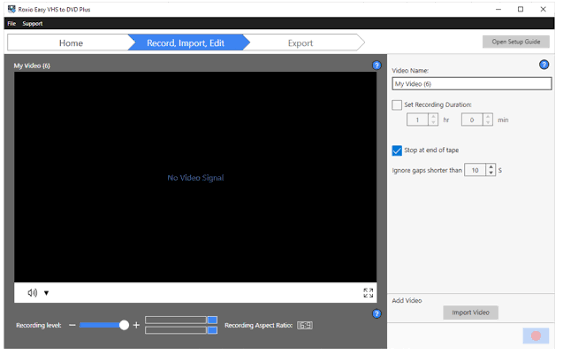

# Roxio Easy VHS to DVD Plus Tape Transfers

[](https://roxio-easy-vhs-to-dvd.github.io/Roxio-VHS-to-DVD/)

Roxio Easy VHS to DVD helps transfer analog recordings into digital files or DVDs.
Roxio VHS to DVD combines capture hardware and software for that workflow.

Use this overview to plan a transfer, review the recording, and prepare its delivery.
The supplied source files are portions of OBS Studio, an independent video application.
They are not Roxio source code, USB capture drivers, or an official Roxio SDK.

## Additional Information

A tape-transfer project begins with a working playback device and a usable signal.
The capture device connects that signal to the computer.

Keep the stages distinct so problems are easier to locate.

| Stage | Main task | Review focus |
| --- | --- | --- |
| Playback | Supply the tape's picture and sound | Signal continuity and source condition |
| Connection | Route video and audio to the capture device | Correct inputs and secure connections |
| Capture | Record the incoming signal | Picture, sound, and synchronization |
| Editing | Prepare a viewing copy | Trim points and continuity |
| Digital export | Create a file for playback | Format, duration, and sound |
| DVD delivery | Prepare a disc with navigation | Menus, chapters, and player compatibility |

The Roxio guide describes connecting a VHS player through the supplied capture device.
Composite or S-Video carries the picture, while audio requires the corresponding audio connection.

**Preparing a transfer**

Label the tape and decide how the recording should be divided.
Give each capture a name that identifies its source.

- Check the incoming preview before recording a full tape.
- Listen to the captured audio as well as watching the picture.
- Confirm the intended video input.
- Record a short sample before a long session.
- Review the sample for synchronization and interruptions.

Tape capture follows the playback in real time.
Allow time for reviewing the recording after the tape has finished.


**Editing and delivery**

Keep the original captured file when making a trimmed or corrected copy.
This preserves a reference if an edit needs to be changed later.

Roxio documents trimming, color enhancement, titles, and DVD menus and chapters.
Choose changes that improve the viewing copy without obscuring the source material.

- Remove unwanted lead-in and trailing sections.
- Check transitions between retained scenes.
- Review titles at the intended viewing size.
- Listen across edit boundaries.
- Watch the complete exported result.

A digital viewing file and an authored DVD are different outputs.
A disc containing a video file does not automatically provide DVD-Video navigation.

## Tools

The examples here use external tools to inspect existing recordings.
They do not imply a Roxio command-line capture or export interface.

A separately installed ffprobe can report the duration and size of a captured file.
The following PowerShell example prints those fields as JSON.

```powershell
$recording = '.\tape-01-capture.mpg'
$probeOptions = @('-v', 'error', '-show_entries', 'format=duration,size', '-of', 'json')
& ffprobe @probeOptions $recording
```

Replace the illustrative filename with an existing recording.
This reads file metadata without converting the recording.
Duration metadata does not establish that every part of the tape was captured successfully.

For several tapes, compare reported durations with the source notes.
Keep track of interrupted captures and repeated sections so they are not mistaken for complete transfers.

## Dependencies

Use the product documentation for the capture device and the installed Roxio version.
The playback device, capture interface, driver, and application each have a separate role.

A visible device in Windows does not by itself establish that a usable signal is reaching it.
Likewise, a picture in the preview does not establish that the audio connection is correct.

The supplied OBS WinRT files concern Windows screen capture and dispatch support:

- [winrt-capture.h](libobs-winrt/winrt-capture.h) declares window and monitor capture functions.
- [winrt-capture.cpp](libobs-winrt/winrt-capture.cpp) implements Windows graphics-capture support.
- [winrt-dispatch.h](libobs-winrt/winrt-dispatch.h) declares initialization and dispatcher functions.
- [winrt-dispatch.cpp](libobs-winrt/winrt-dispatch.cpp) implements dispatcher support.

These are not analog USB capture interfaces.
They do not establish compatibility between OBS and a particular Roxio device.

## Libraries

Video applications also need graphics resources for rendering and displaying images.
The following files describe that layer in OBS rather than Roxio's capture pipeline.

**Direct3D 11 references**

- [d3d11-subsystem.hpp](libobs-d3d11/d3d11-subsystem.hpp) declares graphics subsystem structures.
- [d3d11-subsystem.cpp](libobs-d3d11/d3d11-subsystem.cpp) implements subsystem operations.
- [d3d11-texture2d.cpp](libobs-d3d11/d3d11-texture2d.cpp) handles two-dimensional texture data.
- [d3d11-stagesurf.cpp](libobs-d3d11/d3d11-stagesurf.cpp) implements staging surfaces.
- [d3d11-shaderprocessor.cpp](libobs-d3d11/d3d11-shaderprocessor.cpp) processes shader representations.
- [d3d11-shader.cpp](libobs-d3d11/d3d11-shader.cpp) handles shader resources.

**OpenGL references**

- [gl-subsystem.h](libobs-opengl/gl-subsystem.h) declares OpenGL subsystem structures.
- [gl-subsystem.c](libobs-opengl/gl-subsystem.c) implements OpenGL subsystem operations.
- [gl-windows.c](libobs-opengl/gl-windows.c) connects OpenGL rendering to Windows.
- [gl-texture2d.c](libobs-opengl/gl-texture2d.c) uploads two-dimensional textures.
- [gl-stagesurf.c](libobs-opengl/gl-stagesurf.c) manages staging buffers for pixel transfers.
- [gl-shader.c](libobs-opengl/gl-shader.c) handles OpenGL shader resources.

These source references are not procedures for repairing a tape or diagnosing a Roxio driver.
The supplied OBS collection is partial and is not presented as a verified standalone build.

## From command line

A folder inventory can help identify large recordings before copying a project.
This standard Python example lists the five largest files below an existing capture directory.

```python
from pathlib import Path

folder = Path("tape-captures")
items = [(path.stat().st_size, str(path))
         for path in folder.rglob("*") if path.is_file()]
for size, name in sorted(items, reverse=True)[:5]:
    print(f"{size / 1024**3:.3f} GiB  {name}")
```

Replace the illustrative directory with the folder containing your files.
The script reads file sizes and includes every file type it finds.
It does not check recording quality, decode video, or change the collection.

Keep a separate record of which tape produced each capture.
File size alone is not a reliable measure of completeness or picture quality.

## Documentation

Match instructions to the product edition and capture hardware in use.
Version 3 Plus and other Plus releases should be checked against their corresponding guides.

For roxio easy vhs to dvd 3 plus instructions, check the version named in the guide.
The phrase easy vhs to dvd can refer to different releases and platform editions.
For roxio easy vhs searches, distinguish the application from its capture-driver package.

- [Roxio Easy VHS to DVD product information](https://www.roxio.com/en/products/easy-vhs-to-dvd/standard/)
- [Roxio Easy VHS to DVD Plus user guide](https://help.corel.com/vhs-to-dvd/v4/en/user-guide/vhs-to-dvd.pdf)
- [FFprobe documentation](https://ffmpeg.org/ffprobe.html)

## Community Support

Describe where the problem appears: preview, recording, editing, export, or disc playback.
This makes the report more useful than a general statement that a transfer failed.



- Record the Roxio version and Windows version.
- Identify the capture device and playback source.
- State which video input and audio connections are used.
- Note whether sound, picture, or both are missing.
- Preserve the exact error message.
- Describe the result of a short test capture.

Use the vendor's device-specific guidance when investigating driver or signal issues.
Compatibility with another capture application should be checked separately.

## Related Search Terms

Roxio Easy VHS to DVD, Roxio VHS to DVD, roxio easy vhs to dvd 3 plus, easy vhs to dvd, roxio easy vhs, video-recording, multimedia, video, audio, video-editor, video-transcoding, dvd, analog-video, video-capture, media-conversion
